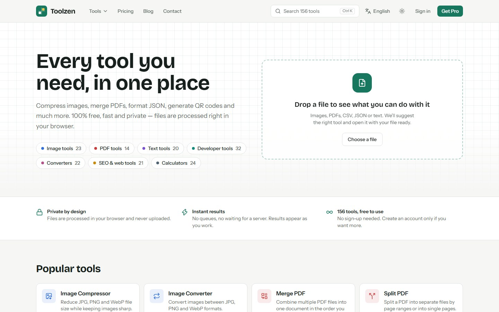
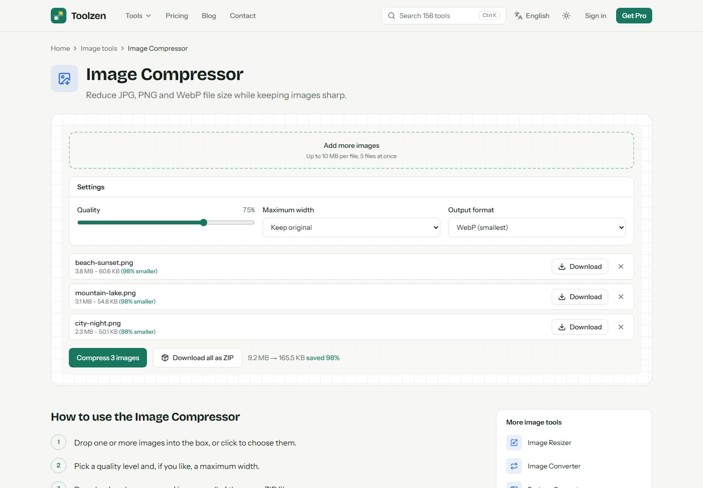
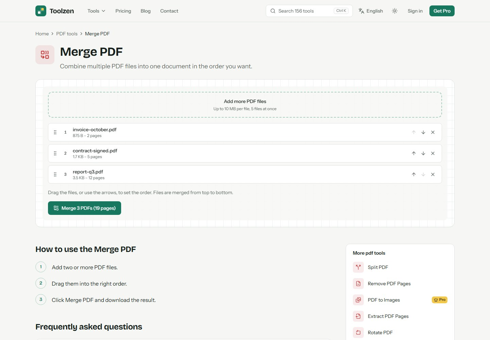
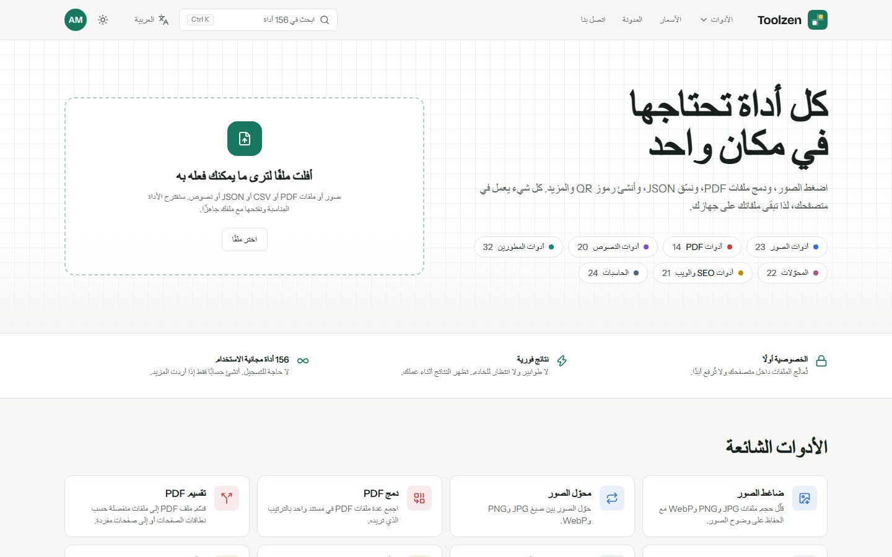
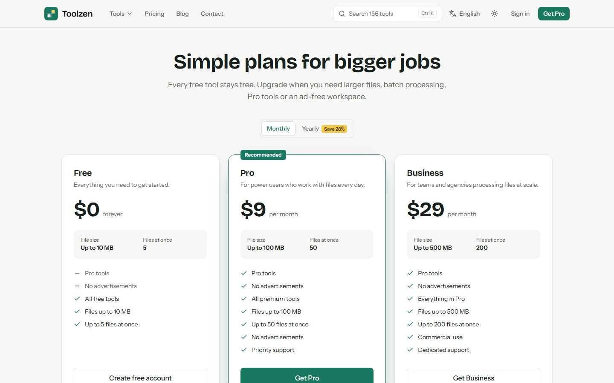
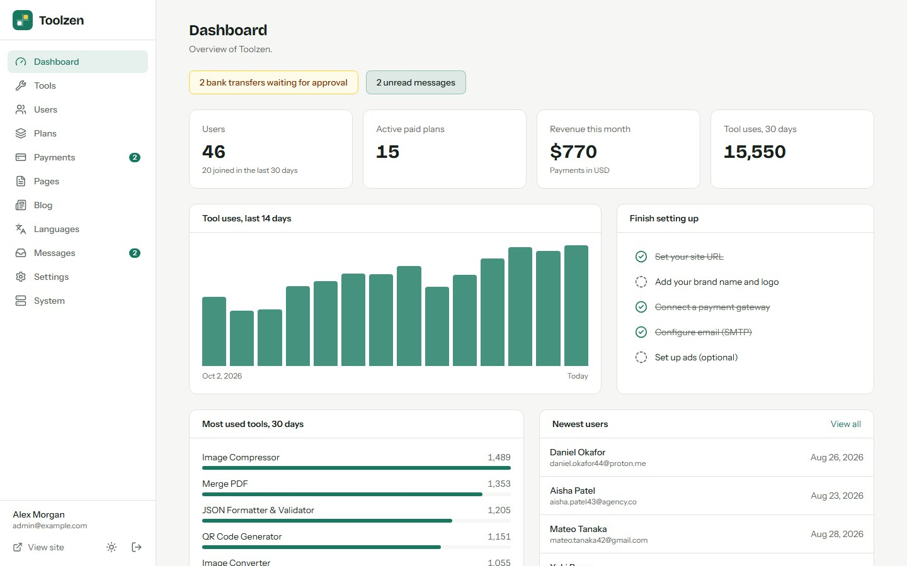
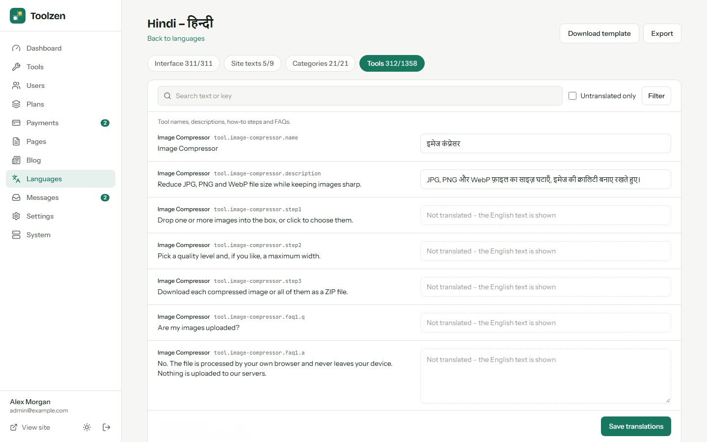

# Toolzen

**Open-source, all-in-one online tools website — 156 tools for images, PDFs, text, developers,
converters, SEO and calculators, with accounts, paid plans, ads, a blog and an admin panel.**
Built with Next.js 16, React 19 and Tailwind CSS 4. Runs on a VPS, Docker, cPanel (Node.js) or
Vercel, with MySQL/MariaDB or a zero-setup SQLite database.

**Live demo:** https://toolzen-sand.vercel.app — log in with `demo@toolzen.app` / `demo12345`
(the admin panel is read-only in the demo).



## Features

- **156 tools:** image compressor and converters, PDF merge/split/sign/organize, JSON/XML/YAML
  formatters, unit converters, finance and health calculators, QR codes and more. 144 of them run
  in the visitor's browser, so files are never uploaded.
- **12 server SEO tools:** DNS, WHOIS, SSL, HTTP headers, redirects, website status, meta tags,
  page size, links, robots.txt, reverse DNS and "what is my IP", with SSRF protection.
- **Drop-a-file finder:** visitors drop any file on the home page and get the matching tools, with
  the file pre-loaded.
- **Multi-language** with right-to-left layouts, a language switcher, an admin translation editor
  and JSON import/export (Arabic and Hindi packs included).
- **Blog:** Markdown posts with cover images, scheduling, related posts, article schema and sitemap
  entries.
- **Monetisation:** paid plans (file-size and batch limits, Pro tools, ad-free browsing) with
  Stripe subscriptions, PayPal, Razorpay (UPI) or bank transfer, plus five AdSense ad slots and an
  ads.txt editor.
- **SEO built in:** per-tool titles and descriptions, FAQ and how-to schema, sitemap.xml,
  robots.txt and Open Graph.
- **Admin panel:** dashboard, tools on/off and Pro flags, users, plans, payments, pages, blog,
  languages, messages and settings.
- **Web installer** — no command line needed on shared hosting. Dark mode, your own brand colour
  and logo, and no external CDNs.

| Image compressor | Merge PDF | Arabic (RTL) |
| --- | --- | --- |
|  |  |  |
| **Pricing** | **Admin dashboard** | **Translation editor** |
|  |  |  |

More screenshots are in [`marketing/final/screenshots`](marketing/final/screenshots).

## Hosted version & paid installation

Need Toolzen hosted for you, installed on your own server, or customised? Contact
**[EpiFive](https://www.epifive.com/services#custom-app-development)**.
- Step-by-step guide: [Toolzen on the EpiFive blog](https://www.epifive.com/blog/toolzen-open-source-online-tools-website-script)
- More open-source projects: [epifive.com/open-source](https://www.epifive.com/open-source)

## Quick start

```bash
git clone https://github.com/epifive/toolzen.git
cd toolzen/app
npm install
npm run dev
```

Open http://localhost:3000 — you are redirected to the web installer at `/install`. Choose
**SQLite** for a zero-setup local database, or **MySQL/MariaDB** for production.

Production, Docker, PM2, cPanel and Vercel setups, payment gateways, ads and every setting are
covered in [`app/README.md`](app/README.md) and the full guide in
[`documentation/index.html`](documentation/index.html) (open it in a browser).

**Requirements:** Node.js 20.9+ (22.13+ for SQLite), MySQL 5.7+ / MariaDB 10.3+ or SQLite, and at
least 1 GB RAM to build.

## Repository layout

| Path | What |
| --- | --- |
| `app/` | The Next.js application (tools, accounts, blog, admin panel, installer) |
| `documentation/` | Full user and admin guide (single HTML file) |
| `marketing/final/` | Screenshots |

## Contributing

Bug reports and pull requests are welcome — please open an
[issue](https://github.com/epifive/toolzen/issues) first for larger changes. New tools are
described in [`app/src/tools/README.md`](app/src/tools/README.md). Run `npm run lint`,
`npm run typecheck` and `npm run build` in `app/` before sending a PR.

## License

[MIT](LICENSE) © 2026 EpiFive
